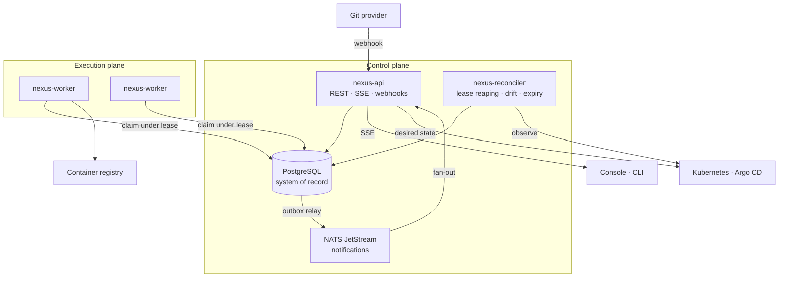

# NEXUS

**Internal Developer Platform / software delivery control plane.**

```
Source → Pipeline → Build → Container → Deploy → Verify → Observe → Recover
```

It takes a commit in a Git repository and drives it through test, build, a real container
image, a real deployment to Docker or Kubernetes, and health verification — and when
verification fails, back out again — recording every state transition as durable,
auditable history.

NEXUS owns its own orchestration. It does not delegate scheduling to Temporal, execution
to GitHub Actions, or reconciliation to Argo CD. Those are integration points; the
pipeline engine, the state machines, the worker protocol and the control loops are the
project.

---

## Why it exists

Most CI/CD demonstrations are a collection of YAML files plus a script that shells out to
`kubectl`. They run a sequence and exit. This is a **control plane**: it holds desired
state, observes actual state, and works continuously to close the gap between them.

The distinction produces most of the interesting engineering here:

| A script runner | A control plane |
|---|---|
| Fails if the process dies mid-run | Recovers, because state is in the database and work is claimed under a lease |
| "It deployed" means the apply returned 0 | "It deployed" means probes observed it serving, with the probe results retained as evidence |
| A lost message loses work | A lost message costs one reconciler interval |
| Two operators can both promote to production | A partial unique index makes that impossible |
| Drift is discovered by a human | Drift is detected, recorded and surfaced |

---

## The engineering problems it solves

These are the parts worth reading the source for.

**Distributing work safely without a distributed lock.** Workers do not receive jobs;
they claim them, with a single `UPDATE ... WHERE id = (SELECT ... FOR UPDATE SKIP LOCKED
LIMIT 1)`. Twelve workers racing get twelve different jobs and no loser is delayed.
Proven by a test that runs 12 workers against 20 jobs and asserts nothing is claimed
twice — [`test/integration/claim_test.go`](test/integration/claim_test.go).

**Surviving worker death without a supervisor.** A claimed job carries a lease. A worker
that crashes, is killed, is partitioned or is simply slow stops renewing it. The
reconciler returns those jobs to the queue with their attempt count intact. Worker death
is not a special case — it is the absence of a heartbeat, handled by the same code path
as any other retry.

**Keeping state changes and their events from diverging.** Publishing inside a handler
has an unavoidable failure window: commit then crash loses the event, publish then roll
back invents one, and neither is detectable afterwards. NEXUS writes the event into an
`outbox` table in the same transaction as the state change and relays it to NATS
afterwards. See [docs/events.md](docs/events.md).

**Refusing to assume a deployment worked.** There is no `DEPLOYING → HEALTHY` transition
in the deployment state machine. The only route to `HEALTHY` runs through `VERIFYING`,
which requires consecutive successful probes inside a deadline. Every probe is persisted,
so the console shows *why* a deployment was considered healthy.

**Making rollback ordinary.** A rollback is a deployment of an earlier release, through
the same apply and the same verification. A rollback that does not come up healthy is
reported as a failed rollback rather than assumed to have worked because it used to.

**Modelling lifecycles as state machines.** Run, job and deployment states are closed
sets with explicit transition tables. Illegal transitions return an error instead of
silently corrupting history — [`internal/core/domain/state.go`](internal/core/domain/state.go).

**Building and deploying the actual artefact.** The `containerise` step runs a real
BuildKit build, tags the image immutably from the commit, and records its digest and
size. That image — not a substitute, not a placeholder — is what the Kubernetes or Docker
provider then runs, which is what makes "roll back to the previous image" a well-defined
operation. See [docs/kubernetes.md](docs/kubernetes.md).

---

## Architecture



Three processes, all horizontally scalable:

| Process | Responsibility |
|---|---|
| `nexus-api` | REST API, webhook ingestion, SSE fan-out, outbox relay |
| `nexus-worker` | Claims jobs, executes steps, renews leases, reports results |
| `nexus-reconciler` | Lease reaping, timeouts, drift detection, preview-environment expiry |

**PostgreSQL is the only system of record.** NATS carries notifications, never truth.
Losing NATS entirely degrades realtime updates; it never loses a pipeline run.

Full detail in [docs/architecture.md](docs/architecture.md).

---

## Stack

Go 1.27 · PostgreSQL 16 · NATS JetStream · Next.js 15 · TypeScript · React 19 ·
OpenTelemetry · Prometheus · Grafana · Docker · Kubernetes · Helm · Argo CD · OpenTofu ·
GitHub Actions

---

## Quick start

**Requires:** Docker Desktop. Nothing else, and no cloud account. Go 1.27+ and Node 20+
only if you intend to work on the code.

```bash
git clone https://github.com/Keathan2609/nexus.git
cd nexus
docker compose -f deployments/docker/docker-compose.yml up -d --build
```

That builds all five images and brings up the entire system: PostgreSQL, NATS,
Prometheus, Grafana and Jaeger, then a one-shot job that applies migrations and seeds a
demonstration estate, then the API, two workers, the reconciler and the console. Two
workers rather than one, so job claiming is genuinely contended and killing one
demonstrates lease recovery with the other still running.

### Deploying to real Kubernetes

```powershell
.\scripts\kind.ps1 bootstrap

$env:NEXUS_DEPLOY_PROVIDER = 'kubernetes'
$env:NEXUS_KUBE_CONTEXT    = 'kind-nexus-local'
$env:NEXUS_KIND_CLUSTER    = 'nexus-local'
.\scripts\dev.ps1 up
```

Pipelines then build a real image, load it into the `nexus-local` cluster, apply a
Deployment and Service, wait for the rollout, and verify the application over its node
port before recording `HEALTHY`. Full detail in [docs/kubernetes.md](docs/kubernetes.md).

### Developing against it

Backing services in Docker, the Go binaries on the host with a fast rebuild loop:

```powershell
.\scripts\dev.ps1 up      # Windows
./scripts/dev up           # macOS, Linux, Git Bash, WSL
```

Then open **http://localhost:3100** and sign in:

| Account | Password | Role |
|---|---|---|
| `admin@nexus.local` | `nexus-demo-password` | Admin |
| `dev@nexus.local` | `nexus-demo-password` | Developer |
| `viewer@nexus.local` | `nexus-demo-password` | Viewer |

### Services

| Service | URL | Notes |
|---|---|---|
| Console | http://localhost:3100 | |
| API | http://localhost:8080 | `/healthz`, `/readyz` |
| API metrics | http://localhost:9095/metrics | Prometheus format |
| Worker metrics | http://localhost:9096, :9098 | One per worker |
| Reconciler metrics | http://localhost:9097/metrics | |
| PostgreSQL | `localhost:5436` | user/password/db `nexus` |
| NATS | `localhost:4222` | monitoring on 8222 |
| Prometheus | http://localhost:9091 | |
| Grafana | http://localhost:3300 | anonymous access, local only |
| Jaeger | http://localhost:16687 | |

Ports are offset from the defaults so this stack runs alongside other projects.

---

## Screenshots

<!-- Capture from a running instance at 1512x945. See docs/screenshots/README.md. -->

| | |
|---|---|
| Overview | `docs/screenshots/01-overview.png` |
| Pipeline run | `docs/screenshots/02-pipeline-run.png` |
| Deployment verification | `docs/screenshots/03-deployment.png` |
| Observability | `docs/screenshots/04-observability.png` |
| Infrastructure | `docs/screenshots/05-infrastructure.png` |

---

## Demonstrating it

### A pipeline, end to end

```bash
./bin/nexus project list
./bin/nexus pipeline run <project-id>
./bin/nexus pipeline watch <run-id>
```

```
+ checkout         succeeded  1.1s
> lint             running
> security-scan    running
> test             running
+ build            succeeded  2.1s
+ containerise     succeeded  1.1s
+ deploy-staging   succeeded  0.9s
+ smoke-test       succeeded  0.6s
+ promote          succeeded  0.3s

Run #13 succeeded in 9.8s
```

Watch the same run in the console at `/console/pipelines/<run-id>` — it updates over SSE
without refreshing.

### A failed deployment and a rollback

```bash
./scripts/demo failure
```

Deploys a build with `FAIL_HEALTHCHECK=true`. The apply succeeds, verification never
passes, the deployment is recorded `FAILED`, and rollback becomes available:

```bash
./bin/nexus environment list
./bin/nexus deployment rollback <environment-id>
```

The rollback runs the same apply and the same verification, and the audit trail records
who asked for it.

### Worker death mid-execution

```bash
./scripts/demo kill-worker
```

Kills a worker while it holds a job. The lease expires, the reconciler requeues the job
with its attempt count intact, and another worker finishes it.

---

## Testing

```bash
go test ./...                                    # unit tests, no dependencies
go test -tags=integration ./test/integration/... # against real PostgreSQL and NATS
cd web && npm run typecheck && npm run lint
```

Integration tests use a separate `nexus_test` database, so the residue they leave never
reaches the estate the console reads.

They cover the failure paths rather than only the happy ones: concurrent claiming, lease
expiry and recovery, retry budget exhaustion, job timeout, outbox atomicity under
rollback, publish failure and backoff, DAG skip propagation, cancellation, and rollback
when there is no healthy release to return to.

---

## Observability

NEXUS instruments itself. `nexus_pipeline_duration_seconds`, `nexus_job_retries_total`,
`nexus_queue_depth`, `nexus_leases_reaped_total`, `nexus_deployment_duration_seconds`,
`nexus_health_checks_total`, `nexus_outbox_pending` and the rest are exported on each
component's `/metrics`. Traces join a webhook to the run it created, the jobs that
executed, the deployment that followed and the probes that verified it, through one
correlation id.

See [docs/observability.md](docs/observability.md).

---

## Infrastructure

- `deployments/docker` — local stack and per-component Dockerfiles
- `deployments/kubernetes` — kustomize base, hardened
- `deployments/helm/nexus` — chart with a values schema that rejects unsafe combinations
- `deployments/argocd` — Argo CD Application reconciling NEXUS itself
- `infrastructure/tofu` — OpenTofu, local Kubernetes by default, AWS opt-in

---

## Security

Argon2id password hashing, HS256 JWTs with the algorithm pinned, API tokens stored as
SHA-256 only, constant-time webhook signature verification, per-principal rate limiting,
strict CSP and security headers, an explicit CORS allowlist, parameterised SQL
throughout, and an append-only audit trail enforced by table permissions rather than by
convention.

See [docs/security.md](docs/security.md).

---

## Documentation

| | |
|---|---|
| [Architecture](docs/architecture.md) | Components, invariants, failure model |
| [Workflow engine](docs/workflow-engine.md) | State machines, DAG planning, retries, leases |
| [Events](docs/events.md) | Outbox, envelopes, idempotency, delivery semantics |
| [Deployments](docs/deployments.md) | Verification, GitOps, drift, rollback |
| [Reliability](docs/reliability.md) | What NEXUS guarantees, and what it does not |
| [Security](docs/security.md) | Boundaries, RBAC, secrets |
| [Observability](docs/observability.md) | Metrics, traces, logs |
| [Kubernetes](docs/kubernetes.md) | The kind cluster, the real deployment path, both failure gates |
| [Local development](docs/local-development.md) | Running and working on it |
| [Decisions](docs/adr/) | Architecture decision records |

---

## Limitations

Stated plainly, because a portfolio project that pretends to be production-complete is
less credible than one that knows its own edges.

- **Argo CD is modelled, not running.** The desired state NEXUS renders is what Argo CD
  would reconcile and the Application manifest exists, but the demonstration applies to
  the cluster directly rather than through a GitOps loop.
- **Preview environments are modelled, not provisioned.** Pull-request environments have
  a lifecycle, an expiry and a reaper, and the reaper works. What they do not have is a
  real ingress and a public URL.
- **Authentication is local.** Users, Argon2id hashes, JWTs and API tokens. The
  `Principal` type is the seam an OIDC provider would sit behind; that provider is not
  implemented.
- **The cluster is a single kind node with no ingress.** Workloads are reached through
  fixed node ports rather than a hostname, and images are loaded into the node because
  there is no registry.
- **The rate limiter is per-process.** N API replicas allow N times the configured rate.
  That is a deliberate trade — it exists to stop one client saturating one replica, not
  to enforce a global quota.
- **Single-tenant in practice.** Every query is organisation-scoped and the schema
  supports several, but nothing has been load-tested with more than one.

---

## Licence

MIT. See [LICENSE](LICENSE).
