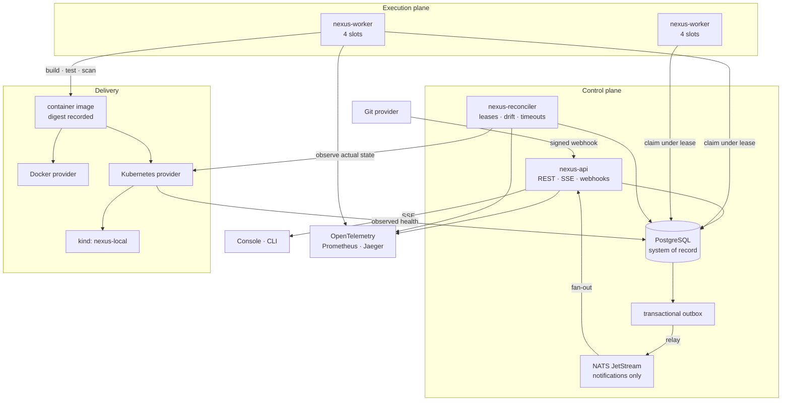

# NEXUS

**An internal developer platform — a control plane for software delivery.**

```
Source → Pipeline → Test → Build → Container image → Deploy → Verify → Observe → Recover
```

NEXUS takes a commit in a Git repository and drives it through tests, a real container
build, a real deployment to Docker or Kubernetes, and health verification against the
running application — and when verification fails, back out again. Every state
transition is durable, auditable history.

NEXUS owns its own orchestration. It does not delegate scheduling to Temporal, execution
to GitHub Actions, or reconciliation to Argo CD. Those are integration points; the
pipeline engine, the state machines, the worker protocol and the control loops are the
project.

---

## Screenshots

<!-- Capture from a running instance at 1512x945. See docs/screenshots/CAPTURE-GUIDE.md. -->

| | |
|---|---|
| Overview | `docs/screenshots/01-overview.png` |
| Pipeline run *(hero)* | `docs/screenshots/02-pipeline-run.png` |
| Deployment verification | `docs/screenshots/03-deployment.png` |
| Infrastructure | `docs/screenshots/04-infrastructure.png` |
| Observability | `docs/screenshots/05-observability.png` |
| Failure and rollback | `docs/screenshots/06-failure-rollback.png` |

---

## Why NEXUS?

### Problem

Shipping one change to production means coordinating a long chain of independent
systems: the source repository, the test suite, security scanning, a container build, an
image registry, one environment per stage, Kubernetes, health checks, telemetry, and —
when something breaks — a rollback and an explanation of what happened.

Each of those tools is competent alone. Together, with nothing owning the whole
sequence, the result is:

- **Fragmented state.** The pipeline knows a build ran. The registry knows an image
  exists. The cluster knows a pod is running. Nothing knows whether the image the
  pipeline built is the image the cluster is running, or which commit it came from.
- **Manual coordination.** Promoting a release means a person watching one system, then
  triggering another, then checking a third.
- **Unobservable progress.** "Where is this change?" is answered by opening four tabs.
- **Assumed success.** `kubectl apply` returning 0 means the API server accepted a
  manifest — not that the application can serve a request.
- **Unclear recovery.** Rolling back means knowing what the previous good release was,
  and whether it is still deployable.
- **No audit trail.** Who deployed what, when, and why, is scattered across systems that
  expire their logs on different schedules.

A CI runner does not solve this, because a runner executes a sequence and exits. Nothing
holds the intended state of the estate, and nothing keeps watching after the run ends.

### Solution

NEXUS is a control plane. It holds **desired state**, observes **actual state**, and
works continuously to close the gap.

| A script runner | A control plane |
|---|---|
| Fails if the process dies mid-run | Recovers: state is in the database, work is claimed under a lease |
| "It deployed" means the apply returned 0 | "It deployed" means probes observed it serving, and the probe results are retained as evidence |
| A lost message loses work | A lost message costs one reconciler interval |
| Two operators can both promote to production | A partial unique index makes that impossible |
| Drift is found by a human | Drift is detected, recorded and surfaced |

Concretely, NEXUS:

1. receives repository events and verifies their signatures,
2. persists a pipeline run and its jobs as a DAG, in one transaction,
3. lets distributed workers **claim** jobs under a lease,
4. executes tests, scans and a real BuildKit container build,
5. records the image reference, digest, size and originating commit,
6. deploys **that** image to Docker or Kubernetes,
7. verifies health by probing the running application, not by trusting the apply,
8. records telemetry, events and an audit entry for every consequential action,
9. detects drift between desired and observed revision,
10. rolls back to a previous release through the same apply-and-verify path.

### Benefits

- **Repeatable deployments** — a release is an immutable (commit, image, digest) triple,
  so deploying it twice does the same thing twice.
- **Less manual coordination** — one system drives the sequence and reports where it is.
- **Delivery state is visible** — one page answers where a change is and what it is
  waiting on.
- **Failure is detected, not reported later** — health verification runs as part of the
  deployment, and the reconciler keeps watching afterwards.
- **Rollback is an ordinary operation** — the same code path as a deployment, with the
  same verification, so a rollback that does not come up healthy is reported as a failed
  rollback rather than assumed to have worked.
- **Recovery after worker failure is automatic** — a lease expires and the job is
  reclaimed, with its attempt count intact.
- **Reproducible execution** — jobs are described by a spec, and retries re-run the same
  spec.
- **Auditability** — every consequential action is recorded with actor, resource and
  correlation id, in an append-only table.
- **Consistent environments** — the same rendered desired state produces every
  environment, differing only by declared values.
- **Horizontally scalable execution** — add a worker process; it registers and starts
  claiming. No coordinator, no rebalancing, no configuration change.

---

## How It Works

```
webhook ──► API ──► [ run + jobs written in one transaction ] ──► outbox
                              │                                     │
                              ▼                                     ▼
                     workers claim jobs                        NATS ──► console
                     under a lease
                              │
                              ▼
              checkout → test → scan → build → containerise
                              │
                              ▼
                    image + digest recorded
                              │
                              ▼
                 deployment ──► apply ──► rollout ──► probe the app
                                                         │
                                              ┌──────────┴──────────┐
                                         HEALTHY                 FAILED
                                                                    │
                                                               rollback
```

Three processes, each horizontally scalable:

| Process | Responsibility |
|---|---|
| `nexus-api` | REST API, webhook ingestion, SSE fan-out, outbox relay |
| `nexus-worker` | Claims jobs, executes steps, renews leases, reports results |
| `nexus-reconciler` | Lease reaping, timeouts, drift detection, preview expiry |

---

## Architecture



**PostgreSQL is the only system of record.** NATS carries notifications, never truth.
Losing NATS degrades realtime updates; it never loses a pipeline run.

Full detail in [docs/architecture.md](docs/architecture.md).

---

## Pipeline Lifecycle

A definition is a DAG of steps. NEXUS plans it with Kahn's algorithm into deterministic
waves — the frontier is sorted before ordering, because Go randomises map iteration and a
pipeline that plans differently on each run is not reproducible.

```
checkout ──┬── lint ──────────┐
           ├── security-scan ─┤
           └── test ──────────┴── build ── containerise ── deploy-staging ── smoke-test ── promote
```

Run, job and deployment lifecycles are **closed state machines with explicit transition
tables**. There is no `PENDING → SUCCEEDED` and no `DEPLOYING → HEALTHY`; the only route
to `HEALTHY` runs through `VERIFYING`. Illegal transitions return an error rather than
silently corrupting history — [`internal/core/domain/state.go`](internal/core/domain/state.go).

When a job finishes, the worker calls the scheduler directly to release dependents rather
than waiting for the next reconciler tick. The reconciler remains as the backstop. That
distinction is worth about 50 seconds per run.

---

## Distributed Execution

**Workers claim work; they are never assigned it.**

```sql
UPDATE jobs SET state = 'RUNNING', worker_id = $1, lease_expires_at = now() + ...
 WHERE id = (SELECT id FROM jobs
              WHERE state = 'QUEUED' AND run_at <= now()
              ORDER BY priority DESC, run_at, id
              FOR UPDATE SKIP LOCKED
              LIMIT 1)
RETURNING ...
```

**Why claiming rather than assignment?** Assignment needs something that decides who gets
what — a scheduler with a view of the fleet, health checks on every worker, and a
rebalancing story for when one dies mid-queue. That component becomes a single point of
failure and the hardest thing in the system to reason about.

Claiming inverts it. A worker takes work only when it has a free slot, which means
capacity is expressed by the worker that actually has it rather than guessed centrally.
There is no leader to elect, no partition map, and no rebalancing: a worker that dies
simply stops claiming. `FOR UPDATE SKIP LOCKED` makes it safe — a row another worker is
claiming is skipped rather than waited on, so N workers claim N distinct jobs without
blocking each other.

Proven by [`test/integration/overload_test.go`](test/integration/overload_test.go), which
runs 16 concurrent claimers against 40 jobs and asserts nothing is ever claimed twice.

---

## Reliability & Failure Recovery

| Failure | Behaviour |
|---|---|
| **Worker crashes** | Its lease stops being renewed. The reconciler returns the job to `QUEUED` with its attempt count intact, and another worker continues. Worker death is not a special case — it is the absence of a heartbeat. |
| **Duplicate webhook** | The delivery id is unique-indexed and `processed_events` guards handlers. The second delivery is recorded as `DUPLICATE` and triggers nothing. |
| **NATS unavailable** | PostgreSQL remains the source of truth. Events accumulate in the outbox with backoff and are relayed when the broker returns. Realtime console updates degrade; no run is lost. |
| **PostgreSQL unavailable** | Operations requiring durable state fail explicitly. `/readyz` reports unavailable and the API returns errors rather than accepting work it cannot persist. Liveness deliberately does *not* check the database — restarting the API during a database blip helps least. |
| **Deployment fails** | Health verification never passes, the deployment records `FAILED` with the cause attached, and the previous release is still live. Rollback restores it through the same apply-and-verify path. |
| **API replica dies mid-deployment** | The reconciler finds deployments stuck in flight beyond a bounded age and fails them, turning an invisible orphan into a visible failure someone can roll back from. |
| **API overloaded** | Rate limiting returns 429; deployment admission control returns 503 with `Retry-After`. Work is refused explicitly rather than accepted and dropped. |
| **Job exceeds its timeout** | The reconciler marks it `TIMED_OUT` and applies the retry policy. |

### Why is health observed rather than assumed?

Because `kubectl apply` returning 0 means the API server accepted a manifest, and a pod
being `Ready` means its readiness probe passed — neither means the application can serve
a request. NEXUS probes the running application through its published port and requires
**consecutive** passes inside a deadline. Every probe is persisted with its status code
and latency, so the console can show *why* a deployment was considered healthy:

```
attempt  target                          status  http  latency
1        http://localhost:30081/healthz  PASS    200   14ms
2        http://localhost:30081/healthz  PASS    200    4ms
3        http://localhost:30081/healthz  PASS    200    8ms
```

### Why PostgreSQL + NATS?

They do different jobs, and conflating them is where this class of system usually goes
wrong.

**PostgreSQL** holds truth. It gives transactions (a run and its jobs are written
atomically), `FOR UPDATE SKIP LOCKED` (the claim protocol), partial unique indexes (one
live deployment per environment, enforced by the database rather than by convention), and
durability. A queue that is a table can be joined, queried, indexed and inspected with
`psql` — which matters far more in practice than raw dequeue throughput.

**NATS** carries notifications so the console updates without polling. It is deliberately
not load-bearing: everything it delivers is also derivable from Postgres. That is why the
outbox exists — the event is written in the same transaction as the state change, then
relayed. Commit-then-publish loses events on a crash; publish-then-commit invents them.
Neither is detectable afterwards.

See [docs/reliability.md](docs/reliability.md) and [docs/events.md](docs/events.md).

---

## Scalability & Overload Behaviour

### What happens when NEXUS is overloaded?

Incoming load does not map one request to one unbounded process. A pipeline submission
writes a run and its jobs and returns; nothing executes inside the request. Workers
expose finite capacity. When every slot is occupied, additional work stays queued, and
workers claim more as they finish.

This absorbs bursts without spawning an uncontrolled number of processes. Under sustained
overload, **queue latency rises before execution capacity is exhausted** — the system
degrades in the direction of waiting rather than failing.

Measured, not asserted:

```
300 pipeline submissions, 30 concurrent  →  all 202 Accepted, 0 failures
                                            queue depth 26 → 317

while the backlog drained:
    queued  running  worker slots
      408      4        4/4
      520      4        4/4
      664      4        4/4
```

**664 jobs queued; exactly 4 running.** Never more than the worker's slot count.

### How does NEXUS scale?

Horizontally, by adding worker processes. Each registers itself and begins claiming.

| Workers | Slots | Jobs completed / 30s |
|---:|---:|---:|
| 1 | 4 | 101 |
| 4 | 16 | 341 |

3.38× throughput for 4× the workers — close to linear; the shortfall is claim contention
on one table, which is expected and is the next ceiling.

Conceptually: 10,000 queued jobs against 20 workers at 4 slots each means 80 jobs
executing and 9,920 waiting. Concurrency is bounded **on purpose**. The alternative turns
10,000 submissions into 10,000 concurrent processes and exhausts the machine.

### Protections that exist

- Bounded worker slots per worker (`NEXUS_WORKER_CONCURRENCY`)
- Bounded database connection pool (16 per process)
- Per-principal API rate limiting (429 + `Retry-After`)
- Deployment admission control (503 when at capacity, refusing *before* persisting)
- Bounded SSE subscribers, refused with 503 before the stream headers are written
- 1 MiB request body cap; webhook payload cap
- Request timeouts, and cancellation propagated through context
- Retry budgets with jittered exponential backoff, and a maximum attempt count
- Keyset pagination with a maximum page size

Read path capacity on one laptop replica, limiter disabled to measure capacity rather
than policy:

| Concurrency | Throughput | p50 | p99 | Failures |
|---:|---:|---:|---:|---:|
| 50 | 2,221 req/s | 20.4 ms | 59.5 ms | 0 |
| 200 | 2,799 req/s | 69.1 ms | 112.1 ms | 0 |

Full method, caveats and what was *not* demonstrated: [docs/performance.md](docs/performance.md).

---

## Security

### How does NEXUS protect sensitive data?

**It mostly avoids holding it.** NEXUS stores secret *references* — a backend and a key —
not secret values. `secret_references` records where a credential lives and who may use
it; no column in it ever holds one. This is the strongest available control: a database
disclosure yields pointers, not credentials, and there is no application-level encryption
key to manage, rotate or leak.

Where a credential must exist, it is stored as a one-way hash:

- **Passwords** — Argon2id, unique per-password salt, constant-time verification. Never
  reversible, never logged.
- **API tokens** — SHA-256 only. The plaintext is returned once, at creation, and cannot
  be retrieved again.

Implemented and verified in this pass:

| | |
|---|---|
| **Tenant isolation** | Every read and write is organisation-scoped **in the store**, so a handler cannot forget. A valid identifier belonging to another organisation returns 404 — indistinguishable from one that does not exist. |
| **RBAC** | Enforced server-side per route. The console hides buttons as a courtesy; the server still checks. Tests attempt rollback, pipeline triggering, project creation and audit reads as a viewer and require 403. |
| **Field tampering** | Explicit request DTOs, and the JSON decoder rejects unknown fields — an attempt to set `id`, `organisation_id`, `created_by` or any server-managed column is a 400 naming the field, not a silently accepted privilege change. |
| **Input validation** | Identifiers are parsed and prefix-checked; branch names are allowlisted; commit SHAs must be hexadecimal; body size, page size, token lifetime and free-text length are all bounded. |
| **Webhooks** | HMAC-SHA256 with constant-time comparison, payload size cap, duplicate-delivery detection, and rejected deliveries persisted for inspection. |
| **Rate limiting** | Per principal where authenticated, per socket address otherwise. `X-Forwarded-For` is ignored unless explicitly trusted — it is client-controlled, and believing it lets a caller land every request in a fresh bucket. |
| **SQL** | Parameterised throughout. No string concatenation of user input; sortable columns are allowlisted. |
| **Logging** | Structured redaction by marker, so `auth_token`, `client_secret`, `set-cookie` and similar never reach output — with measurement suffixes excluded so `token_count` stays readable. |
| **Errors** | Structured and safe. No SQL, driver text, stack traces or filesystem paths reach a client; a test asserts it. |
| **HTTP** | Strict CSP, `X-Content-Type-Options`, `X-Frame-Options: DENY`, `Referrer-Policy`, explicit CORS allowlist that never reflects an arbitrary origin. |
| **Containers** | Multi-stage builds, distroless for the API and reconciler, non-root numeric UIDs, pinned bases. Trivy: **0 HIGH/CRITICAL**. |
| **Kubernetes** | `runAsNonRoot` with a numeric UID, `allowPrivilegeEscalation: false`, read-only root filesystem, all capabilities dropped, `seccompProfile: RuntimeDefault`, resource requests and limits. |
| **Supply chain** | Actions pinned to commit SHAs, least-privilege workflow permissions, dependency and container scanning, SBOM generation, secret scanning over full history. |
| **Audit trail** | Append-only, enforced by table permissions rather than convention. Records actions and actors — never secret values. |

Scans at the time of writing: `gitleaks` clean over all history, `govulncheck` 0 called
vulnerabilities, `npm audit` 0, Trivy 0 HIGH/CRITICAL on both images.

The demo credentials below are **local demonstration credentials only** and are
documented as such. They are not production authentication.

See [docs/security.md](docs/security.md).

---

## Deployment

Two providers behind one interface.

**Docker** runs the image as a container with a published port.
**Kubernetes** renders a Deployment and a NodePort Service, loads the image into the
`kind` node (there is no registry, and `imagePullPolicy: Never` prevents a doomed pull),
waits for the rollout, then probes the application.

Selection **falls back rather than failing**: if Kubernetes is requested and the cluster
is unreachable, NEXUS logs a warning and uses Docker. The console reports the provider
actually in use, not the one configured.

A Kubernetes deployment passes **two independent gates**, and it is worth being precise
about which catches what:

1. **Rollout readiness** — `kubectl rollout status`. An image broken from the start
   stalls here, and the pod events are attached as the cause.
2. **Health verification** — NEXUS probes the application through its node port and
   requires consecutive passes.

An image that comes up, verifies, and degrades later is caught by the reconciler instead.
Both are real failure modes, handled in different places.

See [docs/kubernetes.md](docs/kubernetes.md) and [docs/deployments.md](docs/deployments.md).

---

## Observability

NEXUS instruments itself: `nexus_pipeline_duration_seconds`, `nexus_job_retries_total`,
`nexus_queue_depth`, `nexus_leases_reaped_total`, `nexus_deployment_duration_seconds`,
`nexus_health_checks_total`, `nexus_outbox_pending` and the rest are exported on each
component's `/metrics`.

Traces join a webhook to the run it created, the jobs that executed, the deployment that
followed and the probes that verified it, through one correlation id.

See [docs/observability.md](docs/observability.md).

---

## Tech Stack

Go 1.27 · PostgreSQL 16 · NATS JetStream · Next.js 15 · React 19 · TypeScript ·
OpenTelemetry · Prometheus · Grafana · Jaeger · Docker · Kubernetes · kind · Helm ·
Argo CD · OpenTofu · GitHub Actions

---

## Quick Start

**Requires:** Docker Desktop. Nothing else, and no cloud account. Go 1.27+ and Node 20+
only to work on the code.

```bash
git clone https://github.com/Keathan2609/nexus-control-plane-new.git
cd nexus-control-plane-new
docker compose -f deployments/docker/docker-compose.yml up -d --build
```

That brings up the entire system: PostgreSQL, NATS, Prometheus, Grafana and Jaeger, a
one-shot job that migrates and seeds a demonstration estate, then the API, two workers,
the reconciler and the console. Two workers rather than one, so claiming is genuinely
contended and killing one demonstrates lease recovery with the other still running.

### Against a real Kubernetes cluster

```powershell
.\scripts\kind.ps1 bootstrap

$env:NEXUS_DEPLOY_PROVIDER = 'kubernetes'
$env:NEXUS_KUBE_CONTEXT    = 'kind-nexus-local'
$env:NEXUS_KIND_CLUSTER    = 'nexus-local'
.\scripts\dev.ps1 up
```

Pipelines then build a real image, load it into `nexus-local`, apply a Deployment and
Service, wait for the rollout, and verify the application over its node port before
recording `HEALTHY`.

### Sign in

Open **http://localhost:3100**.

| Account | Password | Role |
|---|---|---|
| `admin@nexus.local` | `nexus-demo-password` | Admin |
| `dev@nexus.local` | `nexus-demo-password` | Developer |
| `viewer@nexus.local` | `nexus-demo-password` | Viewer |

> **Local demonstration credentials only.** They are seeded by the demo seeder, exist so
> the console can be opened without a signup flow, and are not production authentication.
> Nothing here should be reused anywhere else.

### Services

| Service | URL |
|---|---|
| Console | http://localhost:3100 |
| API | http://localhost:8080 (`/healthz`, `/readyz`) |
| API metrics | http://localhost:9095/metrics |
| Worker metrics | http://localhost:9096, :9098 |
| Reconciler metrics | http://localhost:9097/metrics |
| PostgreSQL | `localhost:5436` (user/password/db `nexus`) |
| NATS | `localhost:4222`, monitoring 8222 |
| Prometheus | http://localhost:9091 |
| Grafana | http://localhost:3300 |
| Jaeger | http://localhost:16687 |

Ports are offset from the defaults so this stack runs alongside other projects.

---

## Demo

### A pipeline, end to end

```bash
./bin/nexus pipeline run <project-id>
./bin/nexus pipeline watch <run-id>
```

```
+ checkout         succeeded   1.6s
+ lint             succeeded   1.2s
+ security-scan    succeeded   1.2s
+ test             succeeded   2.1s
+ build            succeeded   2.1s
+ containerise     succeeded  17.4s     ← a real docker build
+ deploy-staging   succeeded   0.9s
+ smoke-test       succeeded   0.6s
+ promote          succeeded   0.3s

Run #14 succeeded in 25.2s
```

### A failed deployment and a rollback

Deploy the deliberately broken image, watch it fail, then roll back:

```bash
./scripts/demo failure
./bin/nexus deployment rollback $(./scripts/demo env-id)
```

What actually happens: the broken pod never passes readiness, so Kubernetes keeps the
previous pod serving; NEXUS records `FAILED / UNHEALTHY`; the rollback redeploys the last
healthy release through the same apply-and-verify path and returns in about five seconds.

```
#20  HEALTHY       r13@manual0     ← rollback
#19  ROLLED_BACK   r99-bad@deadbee ← the failure
#18  SUPERSEDED    r13@manual0
```

### Worker death mid-execution

```bash
./scripts/demo kill-worker
```

Kills a worker holding a job. The lease expires, the reconciler requeues the job with its
attempt count intact, and another worker finishes it.

---

## CLI

```bash
nexus login                       # authenticate and store a token
nexus status                      # control plane health and queue depth
nexus project list
nexus pipeline run <project-id>
nexus pipeline watch <run-id>     # follow until terminal
nexus pipeline logs <job-id>
nexus deployment list
nexus deployment rollback <env-id>
nexus environment list
```

---

## Testing

```bash
go test ./...                                     # unit, no dependencies
go test -tags=integration ./test/integration/...  # against real PostgreSQL and NATS
cd web && npm run typecheck && npm run build
go run ./test/load -scenario=api -requests=5000 -concurrency=50
```

Tests cover the failure paths rather than only the happy ones: concurrent claiming, lease
expiry and recovery, retry budget exhaustion, job timeout, outbox atomicity under
rollback, publish failure and backoff, DAG skip propagation, cancellation, and rollback
when there is no healthy release to return to.

Security tests drive the real router as a hostile client — cross-organisation reads and
writes, role escalation, field tampering, forged tokens, oversized bodies, malformed
identifiers, unsigned webhooks and error-message leakage.

---

## Performance

| | |
|---|---|
| Pipeline, end to end | **25.2s** (of which a real container build is 17.4s) |
| Non-build portion | **7.8s** |
| API reads | 2,221 req/s at 50 concurrent, p99 59.5 ms, 0 failures |
| Rollback to healthy | ~5s |
| Worker scaling | 4 slots → 101 jobs/30s; 16 slots → 341 jobs/30s |

The non-build figure matters because it was once ~60 seconds. Jobs only became
claimable on the next reconciler tick, so every dependency edge cost an interval. Workers
now release dependents directly on completion and the reconciler is the backstop.

Method and caveats: [docs/performance.md](docs/performance.md).

---

## Repository Structure

```
cmd/                    Process entrypoints: api, worker, reconciler, seed, cli
internal/
  api/                  HTTP surface, middleware, SSE hub, admission control
  auth/                 Argon2id, JWT, API tokens, principals
  rbac/                 Roles, permissions, server-side enforcement
  core/domain/          Identifiers and state machines
  core/events/          Event envelopes, correlation and causation
  core/outbox/          Transactional outbox and relay
  scheduler/            DAG planning, wave release, cancellation
  workers/              Worker runtime, step executors, container builds
  build/                ImageBuilder boundary over BuildKit
  deployments/          Desired state, providers, health verification, rollback
  reconciler/           Level-triggered control loops
  webhooks/             Signature verification and ingestion
  store/                PostgreSQL migrations, command and read stores
  platform/             Config, database, logging, telemetry, HTTP helpers
web/                    Next.js console
deployments/            Docker, Kubernetes, Helm, Argo CD, kind cluster
infrastructure/tofu/    OpenTofu modules
observability/          Prometheus, Grafana, OpenTelemetry collector
test/integration/       Tests against real PostgreSQL and NATS
test/load/              Load harness
docs/                   Architecture, reliability, security, performance, ADRs
scripts/                Local development and demonstration helpers
```

---

## Engineering Decisions

- **PostgreSQL as the queue, not Redis or SQS.** Transactional enqueue with the state
  change it belongs to, and a queue that can be joined and inspected.
- **Claiming, not assignment.** No coordinator, no leader election, no rebalancing.
- **Transactional outbox.** The only way to keep a state change and its event from
  diverging.
- **Level-triggered reconciliation.** Read the world and correct it, without caring why
  it diverged — the Kubernetes controller shape. It is the safety net, not the scheduler.
- **Closed state machines with explicit transitions.** Illegal transitions error rather
  than corrupt.
- **Keyset pagination over ULIDs.** Offset paging over a table being written to skips
  and repeats rows; for a run list that gains entries continuously, that is normal
  operation rather than an edge case.
- **Monotonic ULIDs.** `ORDER BY id` means creation order, so no separate sort column.
- **An ImageBuilder boundary.** Domain code never shells out to Docker directly, so the
  container step is testable without a daemon.
- **Distroless for the API and reconciler; Alpine for the worker.** The worker needs a
  shell to run pipeline steps; nothing else does.
- **Scoping in the store, not the handler.** A read that takes only an object id is
  correct exactly as long as every caller remembers to check ownership — and two did not.

Recorded in [docs/adr/](docs/adr/).

---

## Current Limitations

Stated plainly, because a portfolio project that pretends to be production-complete is
less credible than one that knows its own edges.

- **Argo CD is modelled, not running.** The desired state NEXUS renders is what Argo CD
  would reconcile and the Application manifest exists, but the demonstration applies to
  the cluster directly rather than through a GitOps loop.
- **Preview environments are modelled, not provisioned.** They have a lifecycle, an
  expiry and a working reaper. They do not have a real ingress or a public URL.
- **Authentication is local.** Users, Argon2id hashes, JWTs and API tokens. The
  `Principal` type is the seam an OIDC provider would sit behind; that provider is not
  implemented.
- **One kind node, no ingress, no registry.** Workloads are reached through fixed node
  ports, and images are loaded into the node rather than pulled.
- **The rate limiter is per process.** N API replicas allow N times the configured rate.
  A deliberate trade: it exists to stop one client saturating one replica, not to enforce
  a global quota.
- **Single-tenant in practice.** Every query is organisation-scoped and the schema
  supports many, but nothing has been load-tested with more than one.
- **Performance figures are laptop figures.** One API process, one machine. No
  multi-replica test, no sustained soak, and nothing demonstrated at internet scale.
- **One unfixable advisory.** `golang.org/x/crypto/openpgp` is unmaintained upstream with
  no fix available. NEXUS does not call it.

---

## Documentation

| | |
|---|---|
| [Architecture](docs/architecture.md) | Components, invariants, failure model |
| [Workflow engine](docs/workflow-engine.md) | State machines, DAG planning, retries, leases |
| [Events](docs/events.md) | Outbox, envelopes, idempotency, delivery semantics |
| [Deployments](docs/deployments.md) | Verification, GitOps, drift, rollback |
| [Kubernetes](docs/kubernetes.md) | The kind cluster, the real delivery path, both gates |
| [Reliability](docs/reliability.md) | What NEXUS guarantees, and what it does not |
| [Performance](docs/performance.md) | Load method, results, and what was not tested |
| [Security](docs/security.md) | Boundaries, RBAC, secrets, threat model |
| [Observability](docs/observability.md) | Metrics, traces, logs |
| [Local development](docs/local-development.md) | Running and working on it |
| [Portfolio](docs/portfolio.md) | Project summary |
| [Decisions](docs/adr/) | Architecture decision records |

---

## Licence

MIT. See [LICENSE](LICENSE).
