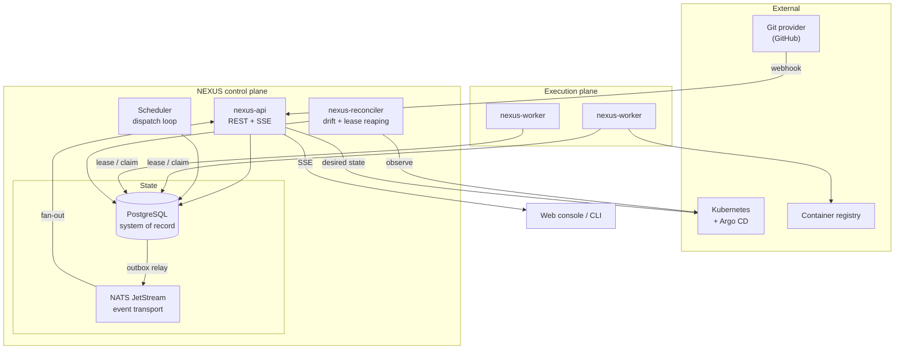

# NEXUS Architecture

NEXUS is a software delivery control plane. It takes a commit in a Git repository and
drives it through test, build, packaging, deployment, health verification and — when
verification fails — rollback, while recording every state transition as durable,
auditable history.

The system is a **control plane**, not a script runner. The distinction matters and
shapes every decision below: a script runner executes a sequence and exits; a control
plane holds *desired state*, observes *actual state*, and continuously works to close
the gap between them. NEXUS owns its own orchestration, scheduling, state machines and
reconciliation rather than delegating them to Argo, Temporal or GitHub Actions.

## Component map



## Design rules

These are the invariants the rest of the system is built on.

### 1. PostgreSQL is the only system of record

Every authoritative fact — run state, job state, lease ownership, deployment history —
lives in Postgres. NATS carries *notifications*, never truth. A total loss of NATS
degrades realtime updates and cross-component fan-out; it never loses a pipeline run,
because the scheduler polls Postgres and would pick the work up regardless.

This is deliberate. A design where the queue holds the work and the database holds a
copy is a design with two sources of truth and a permanent reconciliation problem.

### 2. Work is claimed, not pushed

Workers do not receive jobs. They **claim** them, using a single atomic statement:

```sql
UPDATE jobs SET state='RUNNING', worker_id=$1, lease_expires_at=now()+$2, ...
WHERE id = (
  SELECT id FROM jobs
  WHERE state='QUEUED' AND run_at <= now()
  ORDER BY priority DESC, run_at
  FOR UPDATE SKIP LOCKED
  LIMIT 1
)
RETURNING ...;
```

`FOR UPDATE SKIP LOCKED` makes concurrent claims safe without any distributed lock: two
workers racing for the same job produce one winner and one worker that transparently
takes the next job instead. This is the concurrency primitive the whole execution plane
rests on.

### 3. Leases expire; workers do not need to be trusted

A claimed job carries `lease_expires_at`. A live worker renews it by heartbeat. A worker
that crashes, is killed, loses its network or is stopped mid-job simply stops renewing.
The reconciler reaps expired leases and returns those jobs to `QUEUED` with their attempt
count intact.

The consequence is that **worker death is not a special case** — it is the absence of a
heartbeat, handled by the same code path as any other retry. No supervisor, no worker
registry consistency problem, no split brain.

### 4. State transitions are explicit and centralised

Run, job and deployment states are Go types with an explicit transition table, not
strings compared at call sites. An illegal transition returns an error rather than
silently corrupting history. See [docs/workflow-engine.md](workflow-engine.md).

### 5. State changes and their events commit together

A state change that must produce an event writes the event into an `outbox` table **in
the same transaction** as the state change. A relay process moves outbox rows to NATS
afterwards. Either both happen or neither does. See [docs/events.md](events.md).

### 6. Deployment success is observed, never assumed

A deployment is not healthy because a container started. It becomes `HEALTHY` only after
health verification actually probes it and gets consecutive passes inside a deadline.
Failure to verify is a first-class outcome that drives rollback.

## Process topology

| Process | Cardinality | Responsibility |
|---|---|---|
| `nexus-api` | 1..n, stateless | REST API, webhook ingestion, SSE fan-out, outbox relay |
| `nexus-worker` | 1..n, stateless | Claims jobs, executes steps, renews leases, reports results |
| `nexus-reconciler` | 1 (safe at n) | Lease reaping, drift detection, preview-env expiry, timeouts |

Every process is horizontally scalable. The reconciler is safe to run at n>1 because
each of its loops is expressed as an idempotent, conditional SQL statement rather than a
read-modify-write.

## Package layout

Go code is organised by **domain capability**, not by technical layer. There is no
`models/`, `services/`, `controllers/` triple.

```
cmd/                      process entrypoints
  nexus-api/  nexus-worker/  nexus-reconciler/  nexus/ (CLI)
internal/
  core/domain/            shared identifiers, state machines, errors
  core/events/            event envelope, types, publisher interface
  core/outbox/            transactional outbox writer + relay
  pipelines/              pipeline definitions, runs, DAG planning
  scheduler/              stage advancement, job dispatch
  workers/                worker runtime, lease management, step executors
  deployments/            deployment lifecycle, health verification, rollback
  environments/           environment lifecycle, preview environments
  gitops/                 desired-state rendering, sync + drift model
  projects/ repos/        project import, provider abstraction, detection
  webhooks/               ingestion, signature verification, dedup, routing
  auth/ rbac/ audit/      identity, permissions, audit trail
  api/v1/ api/middleware/ HTTP surface
  store/postgres/         repository implementations
  store/migrations/       SQL migrations
  platform/               config, logging, telemetry, db, ids, clock, httpx
```

`internal/` is used so nothing here becomes an accidental public API.

## Dependency direction

Domain packages define the interfaces they need; `store/postgres` implements them.
Dependencies point inward, toward the domain. No domain package imports `store/postgres`.

Interfaces are introduced where there is a genuine second implementation or a genuine
test seam — the Git provider, the secret store, the health prober, the clock. They are
not introduced for symmetry.

## Failure model

| Failure | Detection | Response |
|---|---|---|
| Worker crashes mid-job | Lease expiry | Job requeued, attempt preserved, backoff applied |
| Duplicate webhook delivery | Unique index on `(provider, delivery_id)` | Second insert is a no-op |
| Duplicate event delivery | Consumer-side `processed_events` guard | Handler runs once |
| Job exceeds timeout | Reconciler deadline sweep | Attempt failed, retried or terminal |
| Deployment unhealthy | Health verifier probes | `FAILED`, rollback offered or automatic |
| Drift from desired state | Reconciler compares desired vs observed | Recorded, surfaced, optionally corrected |
| NATS unavailable | Relay publish error | Outbox rows retained, retried; Postgres unaffected |

See [docs/reliability.md](reliability.md) for the guarantees these add up to.
