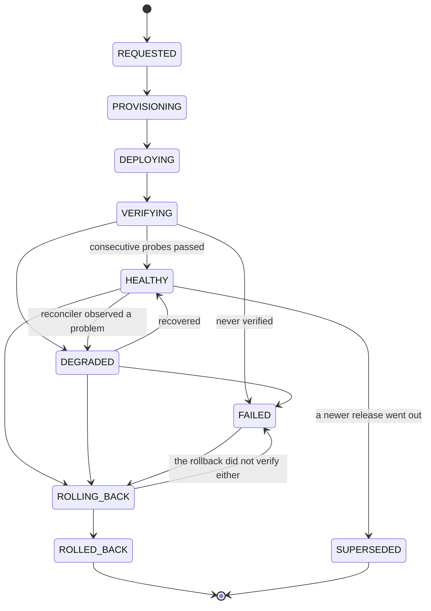
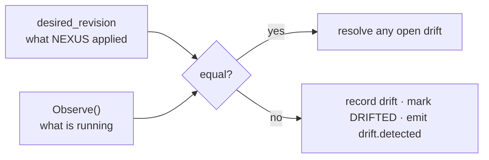

# Deployments

The rule this part of the system exists to enforce: **health is observed, never assumed.**

A successful apply means the cluster accepted the manifests. It says nothing about
whether the process inside the container can serve a request. A container can be
`Running` while the process in it is deadlocked, out of file descriptors, or unable to
reach its database — all states in which "the deployment succeeded" is false.

So there is no `DEPLOYING → HEALTHY` edge in the state machine. The only route to
`HEALTHY` runs through `VERIFYING`.

## Lifecycle



Note `ROLLING_BACK → FAILED`. A rollback that does not come up healthy is a failed
rollback, reported as such rather than assumed to have worked because the release used to.

## Intent and execution are separate

`Request` records that a deployment should happen and returns. It does not deploy.

The separation exists so a request can be made inside the transaction that produced it —
a pipeline finishing, a webhook arriving — while the slow, failure-prone work happens
elsewhere. The API returns `202 Accepted` immediately and the client follows progress on
the event stream.

`Execute` then drives the deployment, persisting each transition as it happens rather
than at the end. A control plane killed halfway leaves a deployment visibly stuck in
`DEPLOYING` rather than silently in `REQUESTED`, and the reconciler fails those after a
bounded age — turning an invisible orphan into a visible failure a person can act on.

## Verification

```go
type Verification struct {
    RequiredPasses int           // consecutive, not cumulative
    MaxAttempts    int
    Interval       time.Duration
    Timeout        time.Duration
}
```

Defaults: three consecutive passes, up to thirty attempts, two seconds apart, inside a
two-minute deadline.

**Consecutive is the important word.** A single failure resets the streak. A cumulative
count would eventually accept a target that alternates between serving and refusing
connections, which is exactly the state a half-broken deployment is in. Asserted by a
test that scripts a flapping prober and requires the deployment to fail.

Every probe is persisted:

| Attempt | Result | Status | Latency | Message |
|---|---|---|---|---|
| 01 | FAIL | 503 | 23ms | service returned 503 during readiness |
| 02 | PASS | 200 | 19ms | |
| 03 | PASS | 200 | 20ms | |
| 04 | PASS | 200 | 14ms | |

The console shows this table rather than a green tick, because "it is healthy" is a claim
and these rows are the evidence for it.

The prober disables HTTP connection reuse deliberately. A pooled connection can succeed
against a process that has already stopped accepting new ones, which would let a dying
service keep passing its health check.

## Appliers

`Applier` is the seam between the lifecycle and whatever actually runs the workload:

```go
type Applier interface {
    Apply(ctx context.Context, d Desired) (string, error)
    Observe(ctx context.Context, environmentID domain.ID) (string, error)
    Destroy(ctx context.Context, environmentID domain.ID) error
}
```

`Observe` is what makes drift detectable. It reports the revision **actually running**,
read back from the runtime, not the revision that was last applied. If those differ,
something changed the world without going through NEXUS.

Three implementations:

- **`DockerApplier`** — the local default. Genuinely starts containers, publishes ports,
  and labels them with the revision; `Observe` reads that label back. A rollback really
  does replace the running container with an earlier image.
- **GitOps rendering** — produces the desired-state manifests for Argo CD to reconcile.
- **`NoopApplier`** — records desired state without touching a runtime. Used by the
  seeder, which needs historical deployments without starting containers for releases
  superseded weeks ago, and by the failure demonstration, which uses `SetObserved` to
  inject drift without anyone editing a live container by hand.

## Desired state and GitOps

Rendering is a pure function of the release, the environment and the service definition.
That is what makes GitOps work at all: the same inputs always produce byte-identical
manifests, so a differing manifest hash means something genuinely changed rather than
that the renderer is non-deterministic.

Manifests are rendered as text rather than assembled through the Kubernetes client
libraries, because the output *is* the artefact — it is what gets committed for Argo CD
to reconcile, what the console shows under desired state, and what is diffed to detect
drift. Text in, text out, no object graph in between.

Each render is stored as a `gitops_revisions` row with a content hash, so the console can
answer "what did NEXUS want at that moment" for a deployment that has since been
superseded.

## Drift

The reconciler compares desired state with what the applier observes, on every cycle:



Two details that keep the signal trustworthy:

- **An unreachable applier is not drift.** A failed `Observe` is skipped rather than
  recorded, because claiming drift on every network blip trains people to ignore the
  signal.
- **One divergence produces one record.** Drift that is already open for the same desired
  revision is not recorded again, so a persistent problem does not generate one row per
  tick.

## Rollback

Rollback is an ordinary deployment of an earlier release, not a reverse operation. It
goes through the same apply and the same verification.

Selecting the target is a single query for the most recent deployment in that environment
whose health was actually `HEALTHY`. When there is none, `ErrNoHealthyRelease` is returned
and the API responds with a `409` saying exactly that — rather than rolling back to
something that never worked.

The deployment records `rollback_of`, `rolled_back_to`, `requested_by` and `reason`, and
the audit trail records the request separately, in the transaction of the change it
describes.

## One live deployment per environment

```sql
CREATE UNIQUE INDEX deployments_one_live_per_environment
    ON deployments (environment_id)
    WHERE state IN ('HEALTHY', 'DEGRADED');
```

A partial unique index, so the database — not application ordering — prevents two
concurrent promotions from both believing they own production.

Superseding the previous deployment happens in the same transaction that marks the new
one healthy, so the constraint is never momentarily violated.

This constraint rejected the first version of the demo seeder, which is the schema doing
its job.

## Preview environments

A pull request opens, a preview environment is created with an expiry, and it is
destroyed when the pull request closes.

Expiry is enforced by the reconciler rather than relying only on the close event, because
that event can be missed — and a preview environment that outlives its pull request is
the one resource in the system that accumulates silently. Nobody notices thirty stale
namespaces until a cluster runs out of room.

The schema constrains preview provenance to preview environments:

```sql
CONSTRAINT environments_preview_fields CHECK (
    kind = 'PREVIEW' OR (pull_request_number IS NULL AND expires_at IS NULL)
)
```
