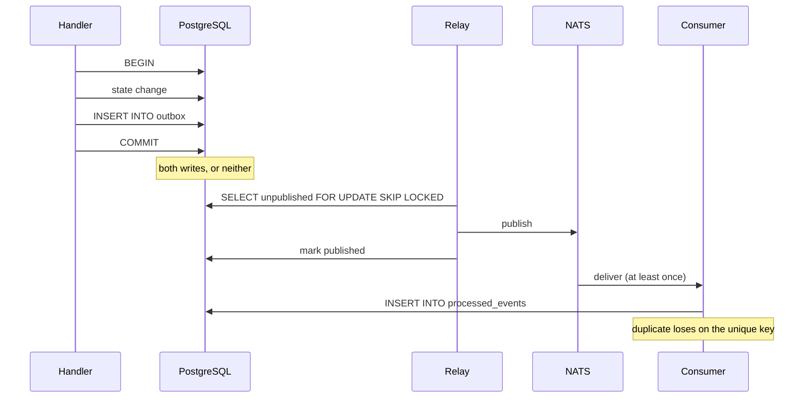

# Events

NEXUS is event-driven, with one deliberate constraint: **events are notifications, not
state.** PostgreSQL is the system of record. An event says "this happened, go look"
rather than carrying authoritative data.

That constraint is what makes the rest of the design possible. Losing NATS entirely
degrades realtime updates and cross-component fan-out; it never loses a pipeline run,
because the scheduler polls Postgres and would pick the work up regardless.

## The problem the outbox solves

Any system that owns both a database and a message broker faces the same unavoidable
choice, and both obvious answers are wrong:

**Publish inside the transaction.** A broker timeout now rolls back work that really
happened. Worse, the publish may have succeeded and the acknowledgement been lost, so the
event exists and the state change does not.

**Publish after committing.** A crash in the window between commit and publish loses the
event permanently, with nothing anywhere recording that it was owed.

Neither failure is detectable after the fact, which is what makes them worse than an
outage. An outage is visible.

## The outbox

A state change that must announce itself writes its event into an `outbox` table **in the
same transaction as the state change**:

```go
tx, _ := db.Begin(ctx)
defer tx.Rollback(ctx)

// ... the state change ...

outbox.Write(ctx, tx, events.New(events.PipelineQueued, "pipeline_run", runID, payload))

tx.Commit(ctx)
```

`outbox.Write` takes a `pgx.Tx` rather than a pool, so it is not possible to write an
event that is not atomic with something else. That signature is the enforcement.

A relay then drains the table to NATS:



The relay selects rows `FOR UPDATE SKIP LOCKED`, so several API replicas can each run one
without publishing the same event twice — the same primitive the job scheduler uses,
applied to a different queue.

A publish failure is recorded against the row and retried with exponential backoff. It is
never returned as an error from `Drain`, because one unreachable subject must not stop the
rest of the backlog. Rows are never marked published unless the publisher actually
returned success — asserted by a test that runs the relay with a failing publisher and
checks that `published_at` is still null.

## The cost: at-least-once delivery

The outbox buys atomicity and pays for it in duplicates. A relay can publish a row,
fail to record that it did, and publish it again on the next drain.

Two defences, at different layers:

**JetStream duplicate suppression.** Each message carries `Nats-Msg-Id` set to the event
id, and the stream has a five-minute duplicate window. This catches the relay case above.

**Consumer-side idempotency.** A handler records the event id in `processed_events` in
the same transaction as its own writes. The primary key on `(consumer, event_id)` means
the second delivery loses the race and the handler skips its side effects. This is the
one that matters, because it does not depend on the broker behaving.

```sql
CREATE TABLE processed_events (
    consumer     text NOT NULL,
    event_id     text NOT NULL,
    processed_at timestamptz NOT NULL DEFAULT now(),
    PRIMARY KEY (consumer, event_id)
);
```

The reconciler prunes rows older than the redelivery window. The guard only needs to
cover that window, not all of history.

## Envelopes

```json
{
  "id": "evt_01m1j6r7q8v65snnhk0ktzfgs7",
  "type": "deployment.healthy",
  "version": 1,
  "aggregate_type": "deployment",
  "aggregate_id": "dep_01m1j6r7rdttpa44cp51xqctj1",
  "correlation_id": "evt_01m1j6r7p2abcdefghijklmnop",
  "causation_id": "evt_01m1j6r7q0zyxwvutsrqponmlk",
  "occurred_at": "2026-09-03T01:29:44.182Z",
  "payload": { "environment_id": "env_...", "revision": "1.3.2@e10bb55" }
}
```

**`correlation_id`** ties every event produced by one logical operation together. A
webhook arrives, a run is queued, nine jobs execute, a deployment is requested and
verified — all of it shares one correlation id, so a single query reconstructs the whole
causal chain across three processes and several minutes.

**`causation_id`** names the specific event that led to this one, which turns that flat
set into a tree. `correlation_id` answers "what else belongs to this?"; `causation_id`
answers "what caused this?".

**`version`** is stamped at `CurrentVersion`. Consumers must tolerate an envelope whose
version is lower than the one they were written against: during a rolling deploy, old and
new producers run side by side and every consumer sees both.

The payload is guaranteed to be a JSON object. The `outbox` table has a
`jsonb_typeof(payload) = 'object'` check constraint, so a nil payload becoming `null`
would fail at INSERT time inside somebody else's transaction, far from the cause —
`marshalPayload` prevents that.

## Event types

Subjects are the dotted type prefixed with `nexus.`, so adding a type does not require
touching any subscription wiring.

| Domain | Types |
|---|---|
| Projects | `project.created`, `repository.connected` |
| Ingestion | `webhook.received` |
| Pipelines | `pipeline.queued`, `pipeline.started`, `pipeline.completed`, `pipeline.failed`, `pipeline.cancelled` |
| Jobs | `job.queued`, `job.started`, `job.completed`, `job.failed`, `job.retrying`, `job.skipped` |
| Deployments | `deployment.requested`, `deployment.started`, `deployment.verifying`, `deployment.healthy`, `deployment.degraded`, `deployment.failed`, `deployment.rolled_back` |
| Environments | `environment.created`, `environment.destroyed` |
| Operations | `drift.detected`, `healthcheck.failed`, `incident.created` |

`job.failed` and `job.retrying` are distinct because they mean different things to anyone
watching: one is a step that is not going to succeed, the other is the system working.

## Delivery to the console

The console subscribes over Server-Sent Events rather than WebSockets. The traffic is
one-directional — the console renders state, it does not push it — and SSE is plain HTTP,
so it passes through the same authentication middleware, the same proxies and the same
logging as every other request, and reconnects on its own.

The hub is fed from NATS rather than directly from the outbox writer, so every API
replica broadcasts every event to its own connected clients. Without that, a console
connected to replica B would miss events produced on replica A.

Subscriber channels are buffered and non-blocking. A slow client's events are dropped
rather than every other client being held up — which is only acceptable because Postgres,
not the channel, holds the truth: a dropped notification costs a moment of staleness, and
the console reconciles by refetching.

## Guarantees

| | |
|---|---|
| A committed state change always has its event | Yes — same transaction |
| An event exists without its state change | Impossible — same transaction |
| Every event reaches NATS eventually | Yes, while the relay runs; retried with backoff |
| An event reaches a consumer exactly once | **No.** At-least-once; handlers are idempotent |
| Events are ordered globally | **No.** Per aggregate they are, by outbox id |
| An SSE client receives every event | **No.** Slow clients drop; they refetch on reconnect |
