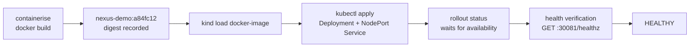

# Kubernetes

NEXUS deploys into a real local cluster. Nothing here needs a cloud account, a registry,
or a paid service.

## The cluster

```powershell
.\scripts\kind.ps1 bootstrap
```

Creates `nexus-local` from [`deployments/kubernetes/kind-cluster.yaml`](../deployments/kubernetes/kind-cluster.yaml),
waits for the node, and creates the namespaces the seeded projects deploy into.

| Command | Does |
|---|---|
| `create` | Create the cluster |
| `bootstrap` | Create it and prepare namespaces |
| `status` | Cluster, nodes, and every NEXUS-managed workload |
| `workloads` | What is running, with revision and image |
| `load-image` | Load a locally built image into the cluster |
| `logs <namespace>` | Logs from a deployed workload |
| `delete` | Remove the cluster |

## Pointing NEXUS at it

```powershell
$env:NEXUS_DEPLOY_PROVIDER = 'kubernetes'
$env:NEXUS_KUBE_CONTEXT    = 'kind-nexus-local'
$env:NEXUS_KIND_CLUSTER    = 'nexus-local'
```

Selection **falls back rather than failing**. If Kubernetes is requested and the cluster
is unreachable, the control plane logs a warning and uses the Docker provider. Refusing
to start would make a cluster a hard dependency of a system that does not need one, and
the Docker path is equally real.

The console reports which provider is actually in use on `/console/infrastructure`, so
what is shown is the applier that is running rather than the one that was configured.

## The delivery path



The image the pipeline builds is the image the cluster runs. There is no substitution
step: the artifact row written by `containerise` is what the release points at, and the
manifest references it by the same immutable tag.

### Why images are loaded rather than pulled

kind nodes run their own containerd, so an image in the host daemon is invisible to
them, and there is no registry serving a locally built tag. The applier runs
`kind load docker-image` before applying, and the manifest sets `imagePullPolicy: Never`
— `IfNotPresent` would still attempt a pull on a node that has not seen the tag.

Loads are cached per image reference. A tag is immutable, so loading it twice is wasted
time rather than a correctness question.

### Why there is a NodePort

Health verification has to reach the **application**, not ask Kubernetes what it believes
about the pod. Those are different claims: a pod can be Ready while the process inside it
cannot serve.

Node ports are fixed per environment kind and declared in the cluster config, because
kind wires `extraPortMappings` into the node container when the cluster is created — a
port computed at deploy time would be assigned by Kubernetes and unreachable from the
host.

| Environment | Node port |
|---|---|
| production | 30080 |
| staging | 30081 |
| development | 30082 |
| preview | 30083 |

## Two gates, not one

A Kubernetes deployment passes through two independent checks, and it is worth being
precise about which catches what:

1. **The rollout gate.** `kubectl rollout status` waits for the Deployment to become
   available. A pod whose readiness probe never passes stalls here, and NEXUS records the
   deployment `FAILED` with the pod events attached as the cause.
2. **Health verification.** Once the rollout completes, NEXUS probes the application
   through the node port and requires consecutive passes before recording `HEALTHY`.

An image that is broken from the start fails the first gate. One that comes up, verifies,
and degrades afterwards is caught by the reconciler instead. Both are real failure modes
and they are handled in different places.

## Observed state

`Observe` reads the revision back from the live workload, and specifically from an
**annotation** rather than the label.

The label is sanitised, because a revision reads as `r21@a84fc12` and `@` is exactly the
character Kubernetes forbids in a label value — the first apply was rejected outright for
this. Sanitising loses information, so the exact revision travels in an annotation where
arbitrary values are allowed, and drift comparison stays byte-exact.

## Security context

Workload pods run with `runAsNonRoot`, a read-only root filesystem, all capabilities
dropped and `seccompProfile: RuntimeDefault`.

The UID is **numeric**. `runAsNonRoot` makes the kubelet verify the user is not root, and
it cannot do that from the string `nonroot` that a distroless image declares — it refuses
the container with `CreateContainerConfigError`. That was found by running it, not by
reading it.

## Verifying by hand

```powershell
.\scripts\kind.ps1 workloads
kubectl --context kind-nexus-local get pods -n checkout-api-staging -o wide
kubectl --context kind-nexus-local describe deployment checkout-api -n checkout-api-staging
curl http://localhost:30081/healthz
```

The application reports the version it was built with, which is how you confirm the
running workload is the artefact the pipeline produced rather than something else.

## Limitations

- **One node.** A multi-node cluster would demonstrate scheduling, which is Kubernetes'
  concern rather than the control plane's, and would triple start-up time on a laptop.
- **No ingress.** Workloads are reached through node ports. A real deployment would put
  an ingress controller in front and verification would target a hostname.
- **Argo CD is modelled, not running.** The desired state NEXUS renders is what Argo CD
  would reconcile, and the Application manifest exists, but the demonstration applies
  directly rather than through a GitOps loop.
- **No registry.** Images are loaded into the node. A multi-node or remote cluster would
  need one.
