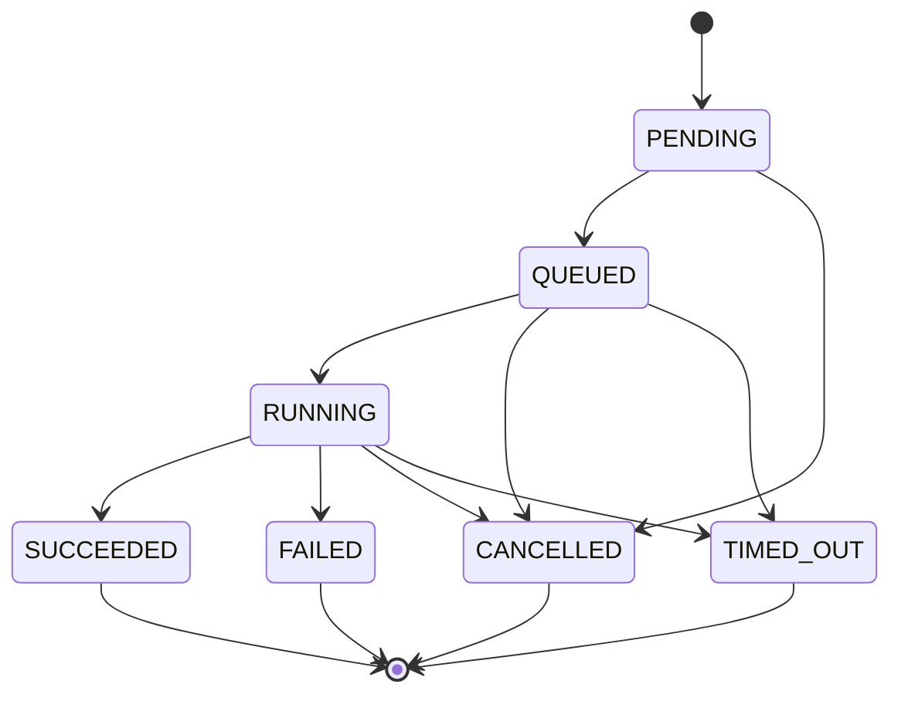
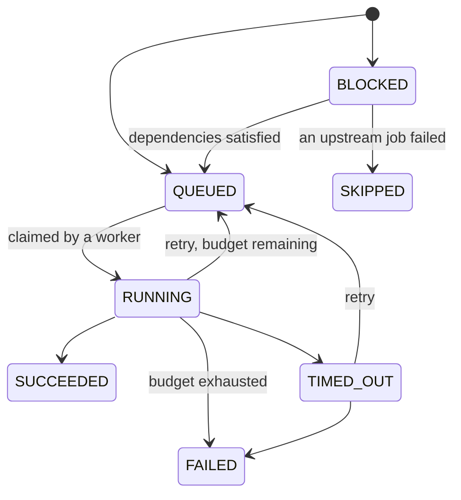

# The workflow engine

The engine turns a pipeline definition into jobs, hands those jobs to workers, and
decides what happens when a job succeeds, fails, times out or is abandoned. It is the
component that makes NEXUS a control plane rather than a script runner, so it is worth
being precise about how it works.

## Lifecycles are state machines, not strings

Runs, jobs and deployments each have a closed set of states and an explicit transition
table. There is one way to move between states — `TransitionTo` — and it refuses illegal
moves.



Two absences in the run table are deliberate:

- **There is no `PENDING → SUCCEEDED` edge.** A run cannot report success without having
  run, even if its DAG turned out to be empty. That case still passes through `RUNNING`,
  so the duration and the job set are recorded honestly.
- **Terminal states have no outgoing edges at all.** A completed run cannot be revived.

The job lifecycle adds three decisions worth pointing at:



- **`RUNNING → QUEUED` is the retry edge.** A failed attempt with budget left does not
  pass through `FAILED` and come back. That keeps `FAILED` meaning "this job is finished
  and it did not work" rather than "this job failed at least once".
- **`BLOCKED → SKIPPED` exists** because the dependents of a failed job did not fail —
  they never ran. Recording them as `FAILED` would make every failure count in the system
  overstate reality.
- **`TIMED_OUT → QUEUED` is legal.** A timeout is a retryable outcome like any other.

## Pipelines are graphs

A definition declares steps and their dependencies. The planner runs Kahn's algorithm
over that graph, producing execution waves: everything in wave *N* may run concurrently
once every step in waves 0..*N-1* has finished.

```
        ┌── lint ──┐
checkout ─ test ───┼─ build ─ containerise ─ deploy ─ verify ─ promote
        └── scan ──┘
```

Two properties of the planner matter more than they look:

**It rejects cycles before any run is created.** A topological sort that cannot consume
every node has found a cycle, and `CycleError` names the participating steps so the API
can tell the user which steps to look at rather than only that the pipeline is invalid.

**Wave ordering is deterministic.** Go randomises map iteration, so the frontier is
sorted at every step. Without that, the same definition would produce differently ordered
waves on successive calls and the console would redraw the graph in a new arrangement on
every poll. Determinism here is a user-visible property, not tidiness.

Waves are a planning view, not the scheduler's runtime model. The scheduler does not wait
for a whole wave — it releases each job the moment that job's own dependencies are
satisfied. Waves exist because they are the right shape for rendering the graph and for
reasoning about the critical path.

## Work is claimed, never assigned

This is the concurrency primitive the entire execution plane rests on:

```sql
UPDATE jobs SET
    state = 'RUNNING', worker_id = $1, attempt = attempt + 1,
    lease_expires_at = now() + make_interval(secs => $2)
WHERE id = (
    SELECT id FROM jobs
    WHERE state = 'QUEUED' AND run_at <= now()
    ORDER BY priority DESC, run_at, id
    FOR UPDATE SKIP LOCKED
    LIMIT 1
)
RETURNING ...;
```

`FOR UPDATE SKIP LOCKED` makes concurrent claims safe with no distributed lock, no leader
election and no external queue. Each worker locks one candidate row; a worker that finds
a row already locked steps past it rather than blocking. Twelve workers hitting this
simultaneously get twelve different jobs, and the loser of any race is never even
delayed.

The `ORDER BY` ends in `id` so that two jobs queued in the same millisecond with equal
priority are still claimed in a stable, defined order.

The index behind it is partial:

```sql
CREATE INDEX jobs_claimable_idx ON jobs (priority DESC, run_at, id)
    WHERE state = 'QUEUED';
```

It holds the claimable backlog rather than every job that has ever existed, which keeps
the dispatch query's working set proportional to the queue rather than to history.

## Ownership is a lease

A claimed job carries `lease_expires_at`. A live worker renews it by heartbeat at a third
of the lease interval, which gives it two chances to renew before expiry — so one slow
database round trip does not cost a worker a job it is actively running.

A worker that crashes, is killed, loses its network or is stopped mid-job simply stops
renewing. The reconciler reaps expired leases and returns those jobs to `QUEUED` with
their attempt count intact.

The consequence is that **worker death is not a special case.** There is no supervisor,
no worker registry to keep consistent, and no distinction between a crash, a kill, a
partition and a graceful stop that did not finish. All of them are the absence of a
heartbeat, and all of them are recovered by the same query.

The heartbeat carries a `worker_id` predicate, which is the safety property: a worker
whose job was reaped and handed to someone else cannot resurrect its ownership by
continuing to heartbeat. It receives `ErrNotOwner` and abandons the work.

That same mechanism is how cancellation propagates. When a run is cancelled, its jobs are
marked cancelled in the same transaction; the running worker discovers this on its next
heartbeat and tears down the subprocess. No worker subscribes to anything.

## Retries are bounded and jittered

Backoff is exponential from two seconds, capped at five minutes, with up to 20% jitter
either way. The jitter matters at fleet scale: without it, N jobs that failed together
because a shared dependency was down all retry at the same instant and knock it over
again the moment it recovers.

Backoff is expressed by pushing `run_at` into the future. Nothing sleeps anywhere.

The retry decision is made inside the SQL statement, from the row's own counters:

```sql
state = CASE WHEN attempt < max_attempts THEN 'QUEUED' ELSE 'FAILED' END
```

Reading the row, deciding in Go and writing back would be a race between however many
workers and reconcilers are running. Making it one statement means two concurrent failure
reports cannot both conclude "one attempt left".

Steps opt in to being retried. `DefaultRetryPolicy` is one attempt, because retrying a
non-idempotent step by default is how a delivery system double-deploys.

## Advancing a run

The scheduler answers exactly one question: given what has finished, what may start now?
It holds no in-memory state, so any replica can advance any run and a restart loses
nothing.

Every decision is a conditional SQL statement over the jobs of one run. A job is released
when no dependency is unsatisfied; a dependency counts as satisfied if it succeeded, or
if it failed but was declared advisory (`continue_on_error`).

Release and skip run in a loop rather than once, because skipping cascades: when `build`
is skipped because `test` failed, `deploy` must then be skipped because `build` was
skipped, and that is a second pass over the same rows. Looping until a pass changes
nothing is simpler and more obviously correct than a recursive CTE, and these graphs are
small.

`Advance` is idempotent. Calling it twice releases nothing the second time, which is
asserted by a test — and is what makes it safe to call from two places:

- **The fast path.** A worker calls it immediately after recording a job result. Without
  this, a nine-step pipeline of one-second steps takes nine reconciler ticks to finish:
  the work takes seconds and the run takes a minute.
- **The safety net.** The reconciler advances every active run on its own schedule
  regardless. A worker that dies between reporting a result and calling the fast path
  costs one interval of latency, not a stalled run.

## What the engine does not do

- **No cron or schedules.** Runs are triggered by webhooks, by the API, or by promotion.
- **No fan-out over dynamic collections.** Steps are declared statically; there is no
  map-over-a-list primitive.
- **No cross-run dependencies.** A run is the unit of scheduling.
- **No priority ageing.** `priority` is honoured but a low-priority job behind a busy
  queue can wait indefinitely.

Each of these is a real limitation rather than an oversight, and each would be a
meaningful piece of work rather than a flag.
